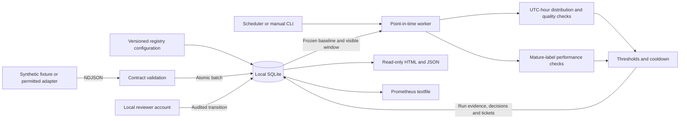

# Architecture and decisions

**M1 · Domain boundary.** Each registry pins one model/version, feature dictionary with units, baseline, horizon and policy. The input adapter supplies immutable observation and label records. SQLite transactions cover an entire import, manual evaluation, worker tick or review. Warehouse, model service and exchange ownership were unspecified. The repository uses an original synthetic generator and a local adapter.

**M2 · Comparison method.** The two-sample Kolmogorov–Smirnov distance measures the maximum empirical CDF gap. It handles tied values without a histogram or fitted density. Thresholds measure effect size. The algorithm compares like UTC hours within each window to account for the simulated intraday cycle. Missingness tests run before distribution or performance decisions. A small stratum produces explicit inconclusive evidence. See the [scoring contract](contracts.md).

**M3 · Time and provenance.** An observation and its label have independent availability clocks. Baseline inputs freeze at baseline end. Current inputs use the evaluation cutoff. Each run stores the model, policy hash, window bounds, cutoff, matched input hashes, sample counts, derived scores and thresholds. Hashes cover canonical JSON arrays sorted by event time and identifier, including visible label availability. Mature-label scores compare the current cohort to the correspondingly mature frozen reference. Earlier runs remain queryable after labels arrive.

**M4 · Operational boundary.** One SQLite writer at a time serializes decisions and reviews. Uniqueness constraints enforce retry semantics. An actionable signal retains its originating run even when cooldown groups it with an earlier incident. A scheduled invocation and an analyst invocation use the same engine. HTML export and Prometheus exposition use read-only connections. Ticket review is the final state-changing operator action.

## Dependency and scale assumptions

The fixture assumes numeric features, a binary target, a positive-class probability, and a fixed forecast horizon. Currency does not enter the calculations. Spread is in basis points. The target and horizon are illustrative, pending owner agreement on the actual strategy, asset class and label definition.

Python's standard library and SQLite provide the entire runtime. The reference run used Python 3.9.6 on macOS. The CI workflow targets Linux. The worker uses local POSIX account identity and a single local filesystem. A scheduled tick scans due window ends, loads the applicable baseline strata into memory and commits as one transaction. Deploy one worker per database for predictable lock duration. The SQLite lock timeout is 30 seconds.

## Unsupported at MVP scope

Categorical, multiclass and regression targets, label corrections, multiple horizons within a registry, exchange calendars, daylight-saving session matching, multivariate dependence drift, and population mix shifts across UTC hours require different contracts or tests. Incomplete coverage can select a biased cohort even above the coverage floor. A completely absent or thin feed is inconclusive until an operator checks upstream delivery. Independent thresholds across many features increase the chance of a flag. Thresholds require validation for each intended model.

The implementation has no network listener, external ticket connector, provider credentials, training, model promotion, trading or execution adapter. Raw database writers belong to one trusted host boundary. Distributed operation, immutable forensic storage, multi-tenant authorization, latency targets and production deployment are outside the verified scope.
