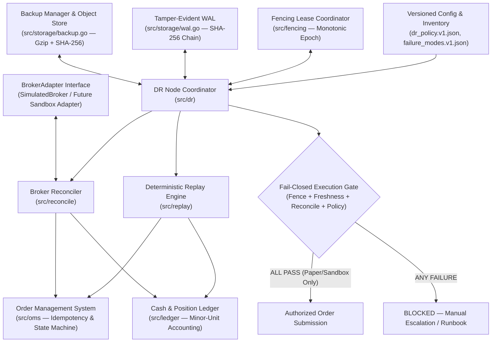
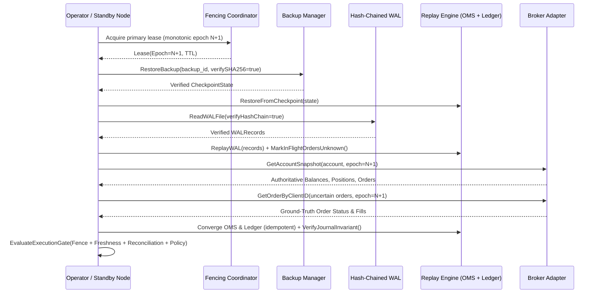

# Architecture — Trading Disaster Recovery Platform

## Overview

The Trading Disaster Recovery Platform recovers trading operations across process crashes, duplicate deliveries, datastore loss, network partitions, split-brain primaries, stale snapshots, backup/WAL corruption, and broker outages while guaranteeing two core invariants:

1. **Order safety:** Recovery never duplicates order intents or fills, and never permits active-active order submission without monotonic fencing.
2. **Fail-closed resumption:** Any unverified external state, stale snapshot/feed, checksum mismatch, or balance discrepancy keeps the execution gate closed until reconciled or escalated.

## Architecture Diagram

## Component Boundaries

| Component | Package(s) | Responsibility & Isolation Boundary |
|---|---|---|
| Failure-mode inventory & recovery objectives | `src/domain`, `config/` | Canonical domain types, ISO-4217 minor-unit accounting, UTC timestamps, structured `DRError` taxonomy, policy & inventory validation. |
| Durable checkpoints & backup/restore | `src/storage` | Append-only `fsync` WAL with per-record SHA-256 chaining; atomic checkpoint backup/restore with gzip compression and SHA-256 manifest verification via `ObjectStore`. |
| Replay & idempotent recovery | `src/replay`, `src/oms`, `src/ledger` | Deterministic state reconstruction from checkpoint + WAL tail, deduplication (`event_id`, `idempotency_key`, `fill_id`), ledger journal-vs-balance invariant verification, crash-recovery `UNKNOWN` order marking. |
| Broker reconciliation & fenced failover | `src/fencing`, `src/reconcile`, `src/dr` | Monotonic epoch lease coordination, split-brain rejection at local gate & broker boundary, snapshot/feed freshness validation, uncertain-order convergence, cash/position reconciliation, fail-closed execution gating. |
| Operator runbooks & drill evidence | `src/dr/drills.go`, `src/cmd/drctl`, `docs/runbook.md`, `scripts/` | Automated 8-scenario failure-path drill suite, RPO/RTO measurement, operator CLI (`drctl`), and retained audit artifacts in `reports/`. |

## Recovery Pipeline Sequence

## Proposed Component Recovery Objectives

Defined in `config/dr_policy.v1.json` (proposals validated in local synthetic drills; not production SLA guarantees):

| Component | Proposed RPO (ms) | Proposed RTO (ms) | Primary Recovery Mechanism |
|---|---:|---:|---|
| `oms_state` | 0 | 5,000 | Synchronous WAL + idempotent replay + broker reconciliation |
| `position_and_cash_ledger` | 0 | 5,000 | Verified checkpoint + WAL replay + journal invariant check |
| `market_data_snapshot` | 5,000 | 10,000 | Freshness gate blocks trading until feed resumes |
| `database_backup_restore` | 1,000 | 30,000 | Verified SHA-256 backup restore + WAL tail replay |
| `broker_gateway_failover` | 0 | 15,000 | Monotonic fenced promotion + mandatory broker reconciliation |
