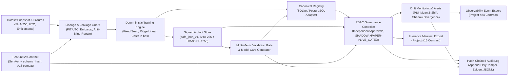

# Architecture, Component Boundaries, and API/Schema Reference

## 1. System Overview

## 2. Component Boundaries

| Component / Workstream | Module(s) | Responsibility and Boundary |
|---|---|---|
| Experiment tracking & artifact registry | `contracts.py`, `errors.py`, `registry.py`, `artifacts.py` | Owns canonical immutable domain contracts, UTC timestamp validation, SemVer parsing, SQLite transactional registry (swappable for PostgreSQL), and SHA-256/HMAC-signed safe JSON artifact bundles. Rejects pickle/joblib/pt and path traversal. |
| Dataset & feature lineage | `lineage.py`, `training.py` | Verifies dataset checksums and entitlements, enforces point-in-time (`availability_ts_utc >= event_ts_utc`), embargoed chronological splits, target-leakage checks, anti-blind-retraining policy, fixed-seed deterministic training, and queryable end-to-end lineage DAGs. |
| Validation gate & model cards | `validation.py`, `model_card.py` | Runs a 10-check multi-metric validation gate (never single-metric promotion), computes bootstrap uncertainty intervals, persists signed/hashed `ValidationReport`, and generates JSON + Markdown `ModelCard`. |
| Paper/shadow promotion workflow | `governance.py`, `platform.py` | Enforces RBAC roles, separation of duties (forbids self-approval), strict stage ordering (`REGISTERED -> VALIDATED -> SHADOW -> PAPER -> LIVE_GATED`), feature version compatibility against serving contracts, cryptographic verification on deploy, and `order_execution_enabled=false` default. |
| Rollback, monitoring & audit controls | `monitoring.py`, `audit.py`, `adapters/external_contracts.py`, `cli.py` | Computes feature PSI, z-score shift, prediction drift, and shadow-vs-champion divergence; emits structured alerts and safe fallback actions (no auto-retrain / no auto-promote); executes integrity-verified rollback; maintains SHA-256 hash-chained audit trail. |

## 3. Core Domain Schemas

- **`DatasetSnapshot`**: `dataset_id`, `version` (SemVer), `source_uri`, `content_sha256`, `schema_hash`, `row_count`, `start_event_ts_utc`, `end_event_ts_utc`, `entitlement`, `license_name`, `asset_class`, `currency`, `is_synthetic`, `snapshot_key` (`<id>@<ver>+<sha16>`).
- **`FeatureSetContract`**: `feature_set_id`, `version` (SemVer), `owner`, `features: Tuple[FeatureSpec, ...]`, `schema_hash`, `version_id` (`<id>@<ver>+<sha16>`, aligned with Project #18 Financial Feature Store).
- **`TrainingJobSpec`**: `idempotency_key`, `model_name`, `model_version`, `strategy_id`, `dataset_snapshot_key`, `feature_set_version_id`, `code_commit`, `seed`, `train_ratio`/`val_ratio`/`test_ratio`, `embargo_seconds`, `hyperparams`, `transaction_cost_bps`, `training_window_policy`.
- **`ExperimentRun`**: tracks both `SUCCEEDED` and `FAILED` / `REJECTED_LEAKAGE` / `REJECTED_POLICY` runs with `spec_hash`, `metrics`, `split_summary`, `artifact_id`, and `failure_code`.
- **`ValidationReport`**: immutable 10-check multi-metric report with `passed`, `checks`, `sample_size`, `environment_info`, `uncertainty` (bootstrap SE and approx 95% CI), and `report_sha256`.
- **`ModelCard`**: immutable governance record linking provenance, intended use, explicit non-goals, dataset/feature lineage, net-of-cost metrics, known limitations, and risk controls.
- **`DeploymentRecord` & `RollbackRecord`**: links every deployed artifact to `dataset_snapshot_key`, `feature_set_version_id`, `code_commit`, `validation_report_id`, `approval_ids`, `artifact_bundle_sha256`, and `order_execution_enabled`.

## 4. Structured Error Codes (`errors.py`)

| Error Code | Trigger |
|---|---|
| `TIMESTAMP_CONTRACT_ERROR` | Naive timestamp, non-UTC offset, or `end_ts < start_ts` |
| `DATA_LEAKAGE_DETECTED` | `availability_ts < event_ts`, future `feature_as_of_ts`, duplicate `(entity, ts)`, insufficient embargo, split overlap, or suspicious near-1.0 target correlation |
| `BLIND_RETRAINING_POLICY_VIOLATION` | `training_window_policy == "recent_returns_only"` or dataset span below `min_training_span_days` |
| `INCOMPATIBLE_FEATURE_VERSION` | Breaking MAJOR bump, older serving MINOR, missing feature, or dtype/unit/currency mismatch |
| `ARTIFACT_TAMPERING_DETECTED` | Bundle file missing, SHA-256 mismatch, registry digest mismatch, or invalid HMAC-SHA256 signature |
| `UNTRUSTED_ARTIFACT_FORMAT` | Presence of `.pkl`, `.joblib`, `.pt`, `.pth`, `.dill`, or unsupported manifest format |
| `PATH_TRAVERSAL_BLOCKED` | Unsafe artifact ID escaping object store root |
| `VALIDATION_GATE_FAILED` | Approving or promoting an artifact without a passing `ValidationReport` |
| `UNAUTHORIZED_PROMOTION` | Actor lacks required role for validation, approval, promotion, or rollback |
| `SELF_APPROVAL_FORBIDDEN` | Artifact creator attempting to approve their own model |
| `INVALID_STAGE_TRANSITION` | Attempting to skip lifecycle stages (e.g., `VALIDATED -> PAPER` without `SHADOW`) |
| `APPROVAL_REQUIREMENT_NOT_MET` | Missing required independent role sign-offs (e.g., dual sign-off for `LIVE_GATED`) |
| `EXECUTION_DISABLED_GUARD` | Attempting to enable live order execution in MVP or in `SHADOW` |
| `IDEMPOTENCY_CONFLICT` | Reusing `idempotency_key` with a different `TrainingJobSpec` |
| `AUDIT_CHAIN_TAMPERED` | Audit log sequence gap, broken `prev_event_hash`, or modified event payload |

## 5. Cross-Project Integration Contracts

- **Project #16 (`low-latency-ml-inference-engine`)**: `InferenceEngineManifestAdapter.to_inference_manifest()` exports verified weights, standardization stats, `artifact_sha256`, `feature_set_version_id`, and `order_execution_enabled=false`.
- **Project #17 (`financial-data-lake`)**: `DatasetSnapshot` captures immutable content hashes, UTC ranges, entitlements, and licensing metadata.
- **Project #18 (`financial-feature-store`)**: `FeatureSpec.version_id` and `FeatureSetContract.version_id` follow the `<name>@<semver>+<sha16>` fingerprint convention and SemVer compatibility rules.
- **Project #24 (`trading-observability-platform`)**: `ObservabilityEventAdapter.from_drift_report()` emits `trading_observability_metric_event_v1` JSON payloads.
