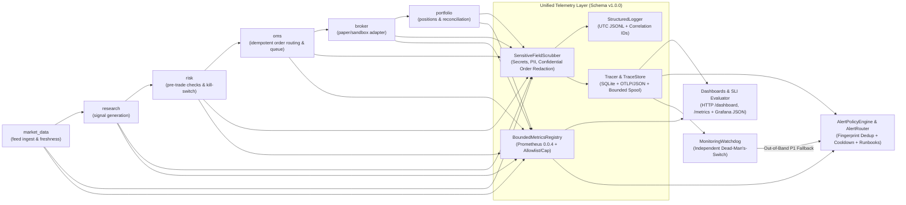

# Architecture — Trading Observability Platform

## System Overview

The platform unifies **metrics**, **structured logs**, **distributed traces**, **dashboards**, **alert routing**, and **self-monitoring** across all six trading services without leaking confidential order details or blocking order processing if the telemetry backend degrades.

## Component Boundaries

| Component | Module(s) | Responsibility & Safety Boundary |
|---|---|---|
| **Common telemetry schema** | `schema.py`, `config.py`, `redaction.py` | Owns canonical versioned contracts (`v1.0.0`), UTC timestamps, W3C `traceparent` propagation, `ExecutionPolicyConfig` fail-closed gate, sensitive-field firewall, and role-based viewer projection. |
| **Metrics, logs & traces** | `metrics.py`, `logging_service.py`, `tracing.py` | Bounded-cardinality Prometheus registry (`__overflow__` folding + forbidden label rejection), redacted JSONL logging, SQLite trace store with OTLP/JSON export, delayed-span tracking, TTL/cap retention, and bounded local spool on backend outage. |
| **Trading health & latency dashboards** | `dashboards.py`, `config/grafana/dashboards/*.json` | Computes reproducible health snapshots, local latency quantiles (`p50`/`p95`/`p99`), SLI checks against `config/slis.json` (`PROPOSED`), and observability self-health. |
| **Alert routing & runbooks** | `alerting.py`, `config/prometheus/alerts.yml`, `config/alertmanager/alertmanager.yml`, `docs/runbooks.md` | Evaluates market data, OMS, broker, reconciliation, risk, cardinality, security redaction, trace delay, and watchdog rules with fingerprint deduplication, cooldown suppression, severity routing, and runbook links. |
| **Pipeline & foundation adapters** | `adapters.py`, `pipeline.py` | Clean `Protocol` interfaces decoupling external market data, research, latency, and broker reconciliation systems from core observability logic; deterministic synthetic paper-sandbox implementations for reproducible testing. |
| **Load & failure scenario evidence** | `scenarios.py`, `tests/scenarios/` | Fixed-seed fault-injection harness verifying all 7 required failure paths plus M3/M4 alert/retention drills and a labeled local synthetic baseline benchmark. |

## Failure Isolation Guarantees

1. **Telemetry backend outage never blocks trading:** `TraceStore.ingest_span` catches backend unavailability and buffers spans into a bounded in-memory spool (`backend_spool_max_events`), replaying automatically upon recovery while raising `TELEMETRY_BACKEND_UNAVAILABLE` via `MonitoringWatchdog`.
2. **Cardinality explosion cannot exhaust memory:** Forbidden keys (`order_id`, `trace_id`, `account_id`, etc.) raise `CardinalityPolicyError`; unknown/excess label values fold into `__overflow__` within strict per-metric and global series limits.
3. **Sensitive data cannot leak to unauthorized viewers:** Every log, span attribute, and alert annotation passes through `SensitiveFieldScrubber`; `/traces/<order_id>` defaults to `VIEWER` and rejects unauthorized `AUDITOR_AUTHORIZED` requests with HTTP `403`.
4. **Execution fails closed:** `config/platform.json` ships with `execution_policy.mode = "DISABLED"`; `LIVE` is hard-rejected; `PAPER_SANDBOX` requires explicit policy ID and reviewer metadata.
